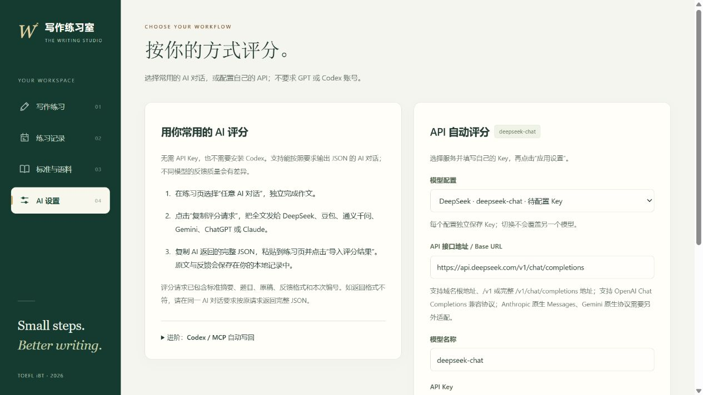

# TOEFL Writing Lab · 托福写作练习室

在自己的电脑上练习 **2026 托福邮件写作和学术讨论**：限时写作 → AI 反馈 → 同题重写 → 回看记录。

**。** 最容易上手的方式是：在网页写完，把评分请求复制给自己常用的 AI，再把反馈粘贴回来。

> 当前提供的是需要下载到电脑运行的程序。GitHub 页面用于下载和查看代码，不是可以直接在线练习的网站。程序不附带作者的 API Key、作文或评分记录。

## 第一次使用：下载并打开网页

### Windows

1. **安装 Node.js。** 打开 [Node.js 官方下载页](https://nodejs.org/zh-cn/download)，安装 Node.js 24，安装选项保持默认。已安装 22.13 或更高版本可跳过。Node.js 是运行本程序所需的软件，不需要购买。
2. **下载并解压。** 点击 [下载程序 ZIP](https://github.com/Marcuseternum/toefl-writing-lab/archive/refs/heads/main.zip)，也可在本页上方点绿色 **Code → Download ZIP**。下载后右键 ZIP →“全部解压”，把文件夹放在以后能找到的位置，例如“文档”。
3. **启动。** 在解压后的文件夹里找到并双击 **`start.cmd`**。同一文件夹应能看到 `index.html`、`server.mjs`、`package.json` 等文件。先解压，不要在 ZIP 内直接运行。
4. **打开网页。** 保持启动后出现的命令窗口运行，在浏览器地址栏输入 **[http://127.0.0.1:8765/](http://127.0.0.1:8765/)**。看到“把想法，写得更清楚。”就启动成功了。

不需要安装 Git、Codex 或其他开发工具，也不需要运行 `npm install`。`127.0.0.1` 指的是你自己的电脑，每个人访问的都是各自启动的程序。

**以后再用：** 双击同一个文件夹里的 `start.cmd`，再打开上面的地址。不要每次重新下载一个新文件夹，否则会进入另一份本地档案。关闭命令窗口会停止服务，关闭浏览器不会删除档案。

### macOS / Linux

同样先安装 [Node.js](https://nodejs.org/zh-cn/download) 24（或 22.13 以上），下载并解压 ZIP。打开终端，进入解压后的文件夹，再运行：

```sh
node server.mjs
```

macOS 可在终端输入 `cd `（末尾留一个空格），将解压后的文件夹拖进终端，再按回车进入文件夹。Linux 可在文件管理器中使用“在终端中打开”。

保持终端运行，浏览器打开 **http://127.0.0.1:8765/**。`start.cmd` 是 Windows 启动文件，macOS / Linux 使用上面的命令。

## 打开以后，选哪种评分方式？

在“写作练习”页上方的 **“评分方式”** 中选择：

| 方式 | 需要准备什么 | 怎样得到反馈 |
| --- | --- | --- |
| **任意 AI 对话（默认，首次推荐）** | 自己能使用的 AI 对话，例如 DeepSeek、豆包、通义千问等 | 复制请求 → 发给 AI → 把 JSON 反馈粘贴回来 |
| **自选 API · 自动评分** | 自己的 API Key、接口地址、模型 ID | 配置当前服务会话后，点击“API 自动评分” |
| **Codex / MCP · 进阶可选** | 已配置 MCP 的 Codex 客户端 | 提交后在 Codex 聊天中要求评阅，反馈自动写回 |

第一种方式就能完成练习、保存反馈和同题重写，可以先跳过 API 和 MCP。AI 账号的额度或收费规则由所用平台决定。

## 完成第一次练习：无需 API Key

1. 选择 **邮件写作** 或 **学术讨论**，再选一道练习题。也可选择“自定义题目 / 粘贴官方练习题”，粘贴自己的完整题目。
2. 评分方式保持 **“任意 AI 对话”**。点“开始计时”，独立完成英文作文；邮件默认 7 分钟，学术讨论默认 10 分钟。
3. 写完点 **“复制评分请求”**。评分标准摘要、题目、作文和返回格式要求会一起复制。**把复制的全文发给自己常用的 AI。**
4. 复制 AI 返回的 **完整 JSON**，回到本程序，粘贴进下方“AI 返回的评分 JSON”输入框，点 **“导入评分结果”**。
5. 查看分数、原文依据、具体修改和改写示范，再打开 **“练习记录”**。这次原稿与反馈已经保存。点“独立重写”可再练同一道题；同题的多次练习会收在一张可展开的卡片里。

**JSON 是 AI 按程序要求返回的结构化文本，你不需要学习或手写，只需复制粘贴。** 如果 AI 只给了普通点评，可在同一对话发送：

> 请按我上一条评分请求中的字段要求，重新输出一份完整 JSON。保留 request_id 和 task_type，原文引用必须逐字对应我的作文，不要省略任何必填字段。

程序会核对格式、请求编号和引用。导入仍失败时，把具体错误提示发给同一 AI，让它修正后重新导入；不要自行修改编号来匹配另一篇作文。

如果浏览器不允许自动复制，页面会展开完整请求。点击文本框，按 **Ctrl+A、Ctrl+C** 手动复制（macOS 用 **Command+A、Command+C**）；也可点击“下载评分请求 .txt”。

## 想一键评分：配置自己的 API

**只有想自动评分时才需要这一步。** 普通 AI 网站的登录账号不等于 API Key，订阅账号也不一定包含 API 额度。

打开右上角 **“AI 设置”**，选择服务配置，填写以下内容：

| 字段 | 填什么 |
| --- | --- |
| 模型配置 | DeepSeek、通义千问、GPT、Claude 或自定义兼容服务，各配置使用独立 Key |
| API 接口地址 / Base URL | 服务商文档提供的 HTTPS 地址，支持根地址、`/v1` 或完整的 `/chat/completions` 地址 |
| 模型名称 | 服务商实际支持、且你的 Key 有权调用的模型 ID，不是自己随便取的名称 |
| API Key | 从该服务商 API 控制台获得的 Key，须与接口地址配套 |
| 服务支持 JSON mode | 按服务商能力选择；若接口报告参数不支持，可取消勾选再应用 |

例如选择 **DeepSeek** 后会预填 `https://api.deepseek.com/v1/chat/completions` 和 `deepseek-chat`，你仍需填自己的 DeepSeek Key，并以服务商实际支持的模型为准。通义千问预设中国区 DashScope，其他区域须改成对应地址。

点击 **“应用设置”**，回到“写作练习”，把评分方式切为 **“自选 API · 自动评分”**，选好模型，写完点击 **“API 自动评分”**。原稿与反馈会自动保存。



API 适配使用 **OpenAI Chat Completions 兼容协议**。Claude 选项需要支持该协议的兼容服务，不能直接填写 Anthropic 原生 Messages 或 Gemini 原生接口。GPT、Claude 的预填模型也不保证适用于你的账号，请按自己的服务商文档修改。可先使用“任意 AI 对话”方式练习。

**开源下载版的 Key 只保存在本机服务内存：刷新网页仍可用，关闭或重启启动窗口后需重新填写。** 调用 API 会将题目与作文发送到你选择的服务；费用由服务商收取，本项目不提供共享 Key 或免费 API 额度。

## 记录在哪里？下次还在吗？

通过 `start.cmd` 或 `node server.mjs` 启动后，档案保存在**程序文件夹里的 `.local/data/writing.sqlite`**，草稿还会在当前浏览器留一份副本。从同一个文件夹重新启动，历史记录仍在。

- **备份已保存练习：** 在“练习记录”点“导出记录 JSON”，换电脑后用“从备份恢复记录”导入。导出包含练习记录和已有反馈，不包含未提交草稿。
- **完整迁移：** 先关闭程序及相关 MCP 进程，再备份整个 `.local/data` 文件夹；其中保留草稿和重写关系等完整档案。升级时先备份，再放回新版本同一位置。
- **离开前保留当前稿：** 可点“保存练习”，或将文字另存。删除程序文件夹前，记得备份其中的个人档案。

程序只监听本机地址，记录不会自动同步到 GitHub 或别人的电脑。只双击 `index.html` 可使用浏览器内的复制评阅，但不会启动本地档案服务或 API 自动评分；推荐按上面的启动步骤使用。

## 遇到问题，先看这里

| 现象 | 处理方式 |
| --- | --- |
| 找不到 `start.cmd` | 先解压 ZIP，再进入程序文件夹；Windows 隐藏扩展名时可能显示为 `start`，类型是“Windows 命令脚本” |
| 找不到 Node.js / `node` 命令 | 安装 Node.js 24 后，关闭旧命令窗口，再双击 `start.cmd`；终端用户可用 `node --version` 检查版本 |
| 无法访问 `127.0.0.1:8765` | 确认程序已启动、命令窗口仍在运行，地址为 `http://127.0.0.1:8765/`。关闭启动窗口会停止服务 |
| 提示端口 8765 被占用 | 如果已开着本程序，直接访问现有服务；否则按[更换端口说明](docs/ADVANCED.md#更换端口)启动 |
| API 自动评分不能点击 | 先启动本地服务，在“AI 设置”填写并应用 Key，再选择 API 评分方式。没有 Key 可用“任意 AI 对话” |
| AI 返回普通点评，或 JSON 导入失败 | 使用上面的重发提示，复制完整返回内容；把具体错误交给 AI 修正格式或原文引用 |
| API 返回 401 / 403 / 404 | 分别检查 Key 是否有效、模型权限是否开通、接口地址和模型 ID 是否正确 |
| API 返回 429 / 503，或超时 | 可能是额度、限流或服务商模型通道问题。原稿仍保留，可稍后手动重试或切换服务；程序不会自动反复调用 |
| 换浏览器或重新下载后看不到历史 | 确认仍从原文件夹启动；不同文件夹默认有各自数据库，可用备份恢复 |

## 练习功能与评分说明

- 邮件与学术讨论限时写作，支持内置原创模拟题和自己的题目。
- 评分绑定提交原稿，核对引用，区分真错误与可选润色。
- AI 内容标题与摘要，同题练习折叠收纳，保留全部通过校验的反馈条目。
- 原稿、独立重写和 AI 示范分别标记，方便比较。
- 邮件改写训练目标 140–150 词、至少 140 词；这是训练偏好，不是原稿评分的机械字数门槛。

采用公开标准进行**单题 0–5 档位练习估分**，不是 ETS 官方评分，未经带分语料校准，不换算正式 1–6 科目分。内置题为原创模拟练习；官方材料通过链接访问，不打包转载整套题库。

## 给开发者和进阶用户

[进阶说明：MCP、数据目录、端口与测试](docs/ADVANCED.md) · [项目设计](IDEA.md)

无第三方运行依赖。`npm test` 使用合成作文与模拟 API，不需要真实 Key。

## 公开依据与许可证

- [ETS 写作评分标准](https://www.ets.org/content/dam/ets-org/pdfs/toefl/writing-rubrics.pdf)
- [ETS 2026 考试规格](https://www.eu.ets.org/pdfs/toefl/toefl-ibt-test-specifications-2026.pdf)
- [ETS 教师练习材料](https://www.ets.org/content/dam/ets-org/pdfs/toefl/toefl-ibt-teachers-resources-practice-test-1.pdf)

项目原创代码、文档和内置原创模拟题采用 [MIT License](LICENSE)。ETS 及其他第三方内容保留各自权利，不属于本项目的 MIT 授权范围。
